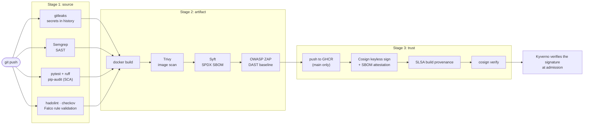

# devsecops-pipeline

[](https://github.com/Engdarwish2019/devsecops-pipeline/actions/workflows/pipeline.yml)


A secure software supply chain on GitHub Actions, end to end: from a commit to a signed,
scanned container image with an SBOM and build provenance, plus the runtime controls that
protect it in Kubernetes (Vault for secrets, Falco for detection). The application is a small
FastAPI service on purpose: the pipeline is the product.

The image this pipeline publishes is the one deployed and verified by
[platform-gitops](https://github.com/Engdarwish2019/platform-gitops).

## Pipeline



| Stage | Tool | Fails the build when |
|---|---|---|
| Secrets | gitleaks | Any secret in the git history |
| SAST | Semgrep (`p/python`, `p/owasp-top-ten`, `p/dockerfile`) | Any finding; results go to GitHub code scanning |
| Tests | pytest, ruff | A test fails, lint or format issues, coverage under 90% |
| SCA | pip-audit | A known vulnerability in a dependency |
| Config | hadolint, checkov, Falco `-V` | Dockerfile or Kubernetes misconfiguration, invalid Falco rules |
| Image | Trivy | A HIGH or CRITICAL vulnerability that has a fix |
| SBOM | Syft | |
| DAST | OWASP ZAP baseline | Missing CSP, anti-clickjacking or nosniff headers, or a version-leaking `Server` header (`.zap/rules.tsv`) |
| Sign | Cosign keyless (GitHub OIDC + Rekor) | Signing or verification fails |
| Provenance | `actions/attest-build-provenance` | |

No long-lived credentials anywhere: GHCR uses the job's `GITHUB_TOKEN`, signing uses the
workflow's OIDC identity, and the optional Vault job authenticates with OIDC too. Every job starts
from `permissions: contents: read` and only the build job gets write scopes.

## Runtime

| Control | Where |
|---|---|
| Non-root (UID 10001), read-only root FS, no capabilities, seccomp `RuntimeDefault` | `Dockerfile`, `k8s/deployment.yaml` |
| Pod Security `restricted`, default-deny NetworkPolicy (DNS and Vault egress only) | `k8s/` |
| Secrets injected by the Vault Agent, Kubernetes auth bound to the service account | `k8s/deployment.yaml`, `vault/` |
| CI reads Vault through GitHub OIDC, bound to this repo and `main` | `vault/setup.sh`, `vault-secrets` job |
| Runtime detection: shells, unexpected processes, package managers, outbound connections | `falco/rules/demo-api-rules.yaml` |

The [threat model](docs/threat-model.md) maps each control to a STRIDE threat.

## Verify an image yourself

```bash
cosign verify ghcr.io/engdarwish2019/devsecops-pipeline:main \
  --certificate-identity-regexp '^https://github.com/Engdarwish2019/devsecops-pipeline/.github/workflows/' \
  --certificate-oidc-issuer https://token.actions.githubusercontent.com

# SBOM attached to the image
cosign verify-attestation --type spdxjson ghcr.io/engdarwish2019/devsecops-pipeline:main \
  --certificate-identity-regexp '^https://github.com/Engdarwish2019/devsecops-pipeline/' \
  --certificate-oidc-issuer https://token.actions.githubusercontent.com | jq -r .payload | base64 -d | jq .predicate.name

# GitHub build provenance
gh attestation verify oci://ghcr.io/engdarwish2019/devsecops-pipeline:main --owner Engdarwish2019
```

## Run locally

```bash
pip install -r app/requirements.txt -r app/requirements-dev.txt
pytest --cov=app
uvicorn app.main:app --port 8080

docker build -t demo-api .
docker run --rm -p 8080:8080 --read-only --cap-drop ALL demo-api
```

## Deploy the runtime pieces

```bash
# Vault (Kubernetes auth + GitHub OIDC)
export VAULT_ADDR=https://vault.example.com
./vault/setup.sh

# Falco with the custom rules
helm repo add falcosecurity https://falcosecurity.github.io/charts
helm install falco falcosecurity/falco -n falco --create-namespace \
  -f falco/values.yaml \
  --set-file 'customRules.demo-api-rules\.yaml=falco/rules/demo-api-rules.yaml'

kubectl apply -f k8s/
```

## License

MIT
